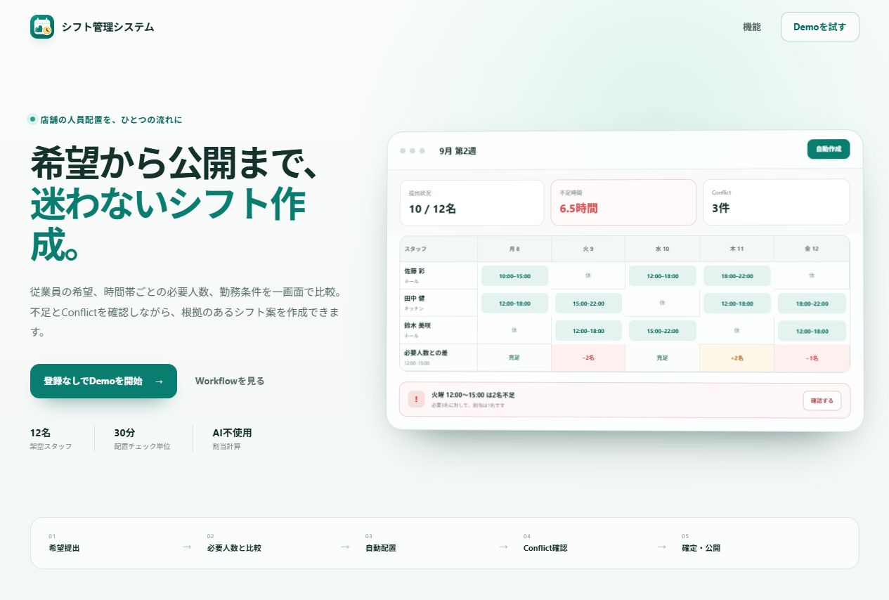
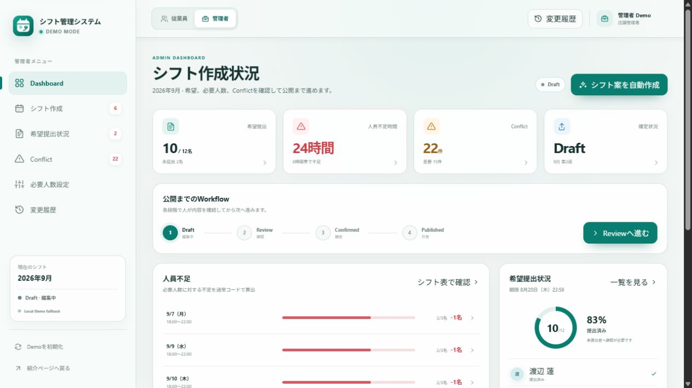
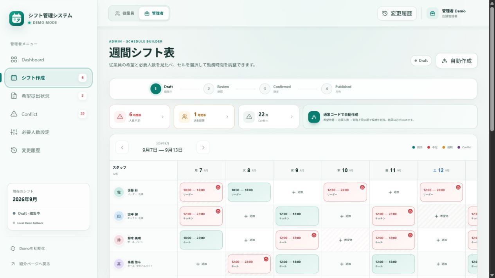
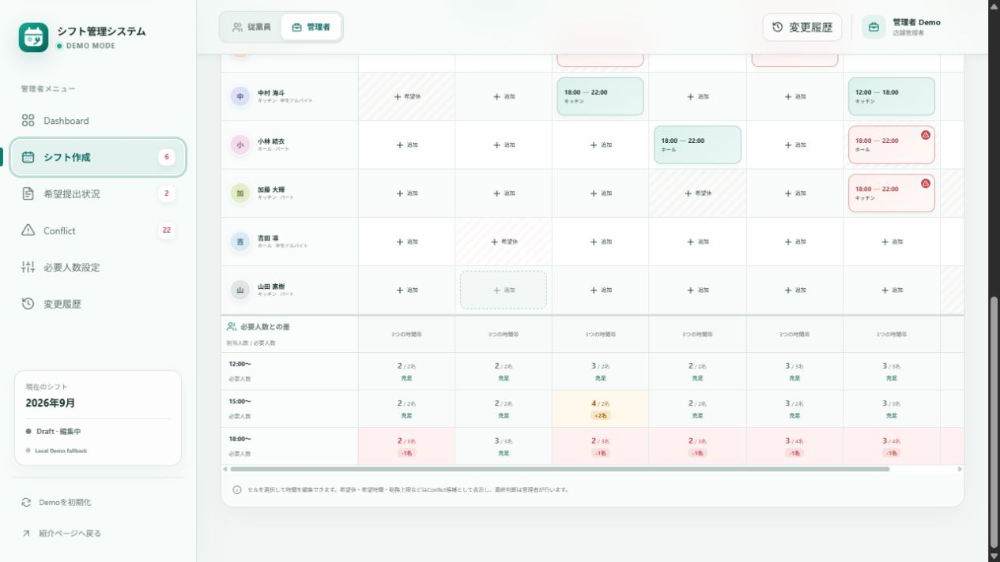
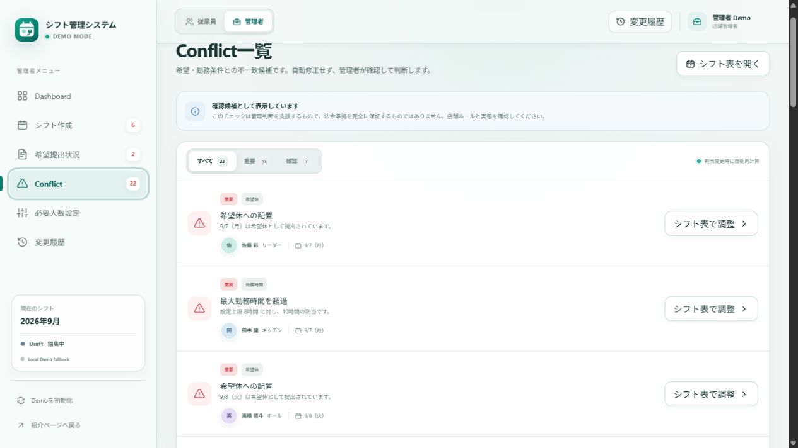
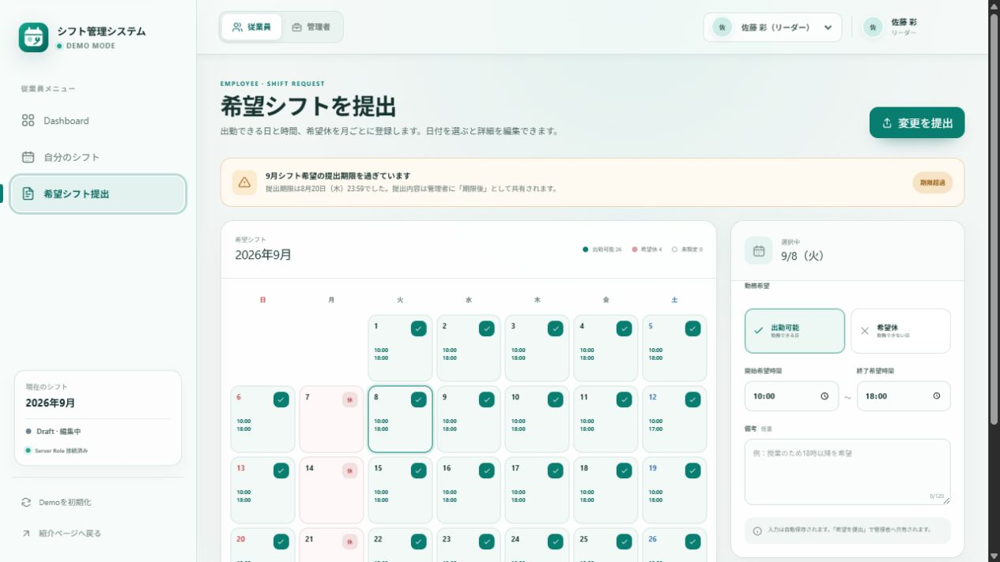
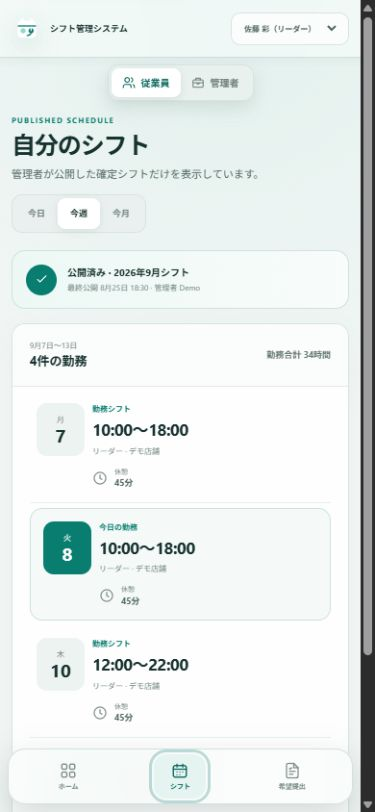

# シフト管理システム — Screenshots

公開中の[シフト管理システム](https://shift-management-system.kinjo653222.chatgpt.site)から、2026年8月22日に撮影した実画面です。表示データはすべて架空のDemoデータです。

## 1. ランディング

## 2. 管理Dashboard

## 3. 週間シフト表

## 4. 必要人数との比較

## 5. Conflict一覧

## 6. 希望シフト提出

## 7. Mobile公開シフト

